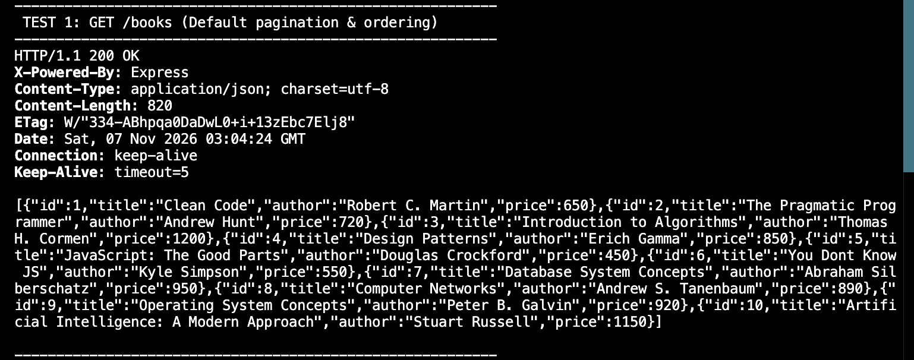
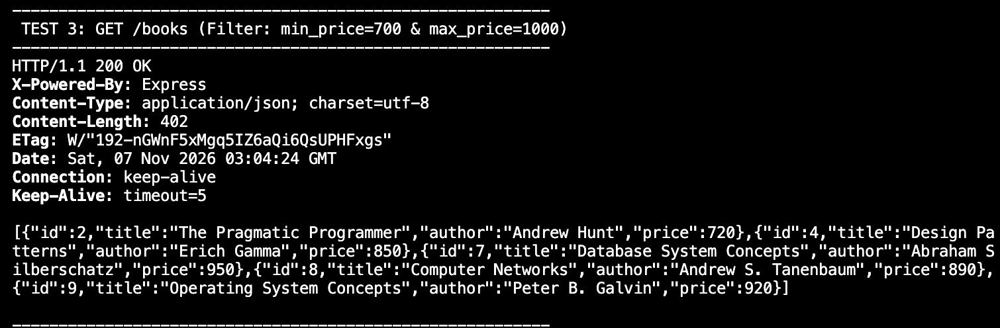
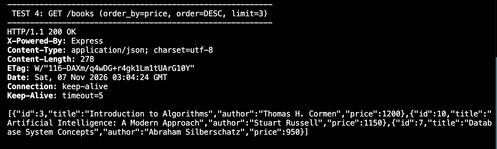
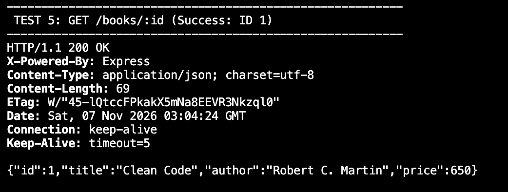
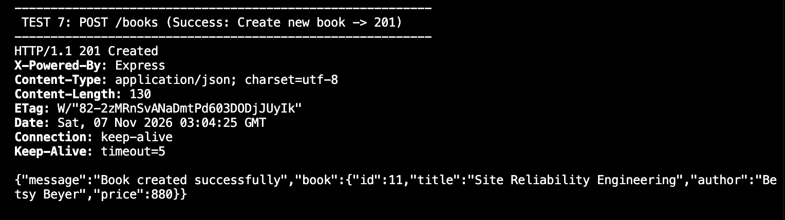
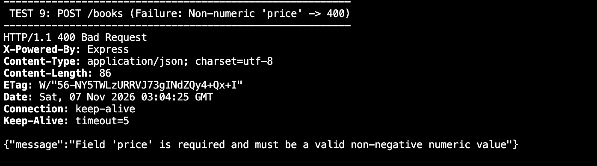
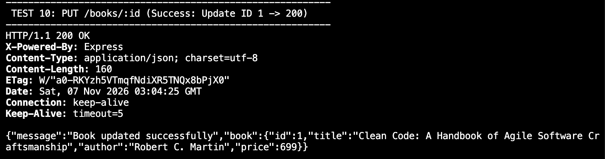

# Lab 3: Advanced SQL Filtering, Query Parameters, and CRUD REST API

## Student & Course Details
- **Student Name:** Narala Sai Manuharsha
- **Registration Number:** 252U1R8063
- **Section:** CSE-QE-2B-204
- **Faculty:** Chintakrindi Sai Siva Teja
- **Course:** Backend Development Fundamentals (Aurora University)
- **Live link:** Not applicable

---

## 1. Project Overview
This laboratory experiment demonstrates production-grade RESTful API development using **Node.js**, **Express.js**, and **SQLite**. It emphasizes safe database querying, robust input validation, dynamic SQL query composition using parameterized statements, and advanced query parameter support (search, range filters, sorting, and pagination).

### Key Features:
- **Relational Data Modeling:** Auto-initialized SQLite database file (`books.db`) with an auto-incrementing `books` table.
- **SQL Injection Prevention:** 100% of queries use parameterized bindings (`?`). Dynamic column sorting enforces a strict whitelist.
- **Advanced Query Parameters:**
  - `search_q`: Substring / case-insensitive search on `title` via `LIKE %...%`.
  - `min_price` and `max_price`: Range filter conditions (`price >= ? AND price <= ?`).
  - `order_by` & `order`: Dynamic sorting with safe fallback defaults (`id`, `ASC`).
  - `limit` & `offset`: Offset-based pagination with input validation.
- **Standardized Error Handling:** Consistent JSON error envelopes with explicit HTTP status codes (`200 OK`, `201 Created`, `400 Bad Request`, `404 Not Found`, `500 Internal Server Error`).
- **Security & Privacy:** Request logging middleware excludes sensitive headers and prevents sensitive credentials from being logged in plain text.

---

## 2. Database Schema

The database `books.db` maintains the following table structure:

```sql
CREATE TABLE IF NOT EXISTS books (
  id INTEGER PRIMARY KEY AUTOINCREMENT,
  title TEXT NOT NULL,
  author TEXT NOT NULL,
  price INTEGER NOT NULL
);
```

---

## 3. How to Run

### Prerequisites
- Node.js (v16.x or later)
- npm (Node Package Manager)
- bash & curl (for executing automated tests)

### Installation
Navigate to the `lab3` directory and install project dependencies:
```bash
cd lab3
npm install
```

### Start the Application
- **Production mode:**
  ```bash
  npm start
  ```
  *(Runs `node server.js` on default port `3000`)*

- **Development mode (Auto-reload on changes via nodemon):**
  ```bash
  npm run dev
  ```

- **Custom Port configuration:**
  ```bash
  PORT=4000 npm start
  ```

### Run Automated CLI Tests
With the server running in one terminal, execute the test suite in a second terminal:
```bash
bash run_tests.sh
# or
npm test
```

---

## 4. Endpoints Table

| Method | Path | Query / Body Parameters | Status Code | Description |
| :--- | :--- | :--- | :--- | :--- |
| `GET` | `/books` | `search_q`, `min_price`, `max_price`, `order_by`, `order`, `limit`, `offset` | `200 OK` / `400 Bad Request` | Retrieves filtered, sorted, and paginated list of books. |
| `GET` | `/books/:id` | Path param: `id` | `200 OK` / `404 Not Found` | Retrieves a single book by ID. |
| `POST` | `/books` | Body: `{ "title": string, "author": string, "price": number }` | `201 Created` / `400 Bad Request` | Validates input and creates a new book record. |
| `PUT` | `/books/:id` | Path param: `id`, Body: `{ "title": string, "author": string, "price": number }` | `200 OK` / `400 Bad Request` / `404 Not Found` | Updates an existing book record completely. |
| `DELETE` | `/books/:id` | Path param: `id` | `200 OK` / `404 Not Found` | Deletes a book record by ID. |
| `*` (All) | *(Any undefined path)* | None | `404 Not Found` | Catch-all handler for unknown routes. |

---

## 5. Test Evidence

The following screenshots demonstrate manual and CLI verification for each operational requirement. Match your screenshot captures to the paths below in `screenshots/`:

### 5.1 GET /books (Default Listing)


### 5.2 GET /books with search_q Title Filter


### 5.3 GET /books with Price Range Filters (min_price & max_price)


### 5.4 GET /books with Sorting & Pagination (order_by, order, limit)


### 5.5 GET /books/:id (Success)


### 5.6 GET /books/:id (Missing Record 404)


### 5.7 POST /books (Success 201 Created)


### 5.8 POST /books (Validation Failure 400 Bad Request)


### 5.9 PUT /books/:id (Success 200 OK)


### 5.10 PUT /books/:id (Missing Record 404)


### 5.11 DELETE /books/:id (Success 200 OK)


### 5.12 DELETE /books/:id (Missing Record 404)


### 5.13 Unknown Route Catch-All (404)


---

## 6. Viva Questions & Comprehensive Answers

### Q1: What is the difference between a Query Parameter and a Path Parameter?
- **Path Parameter (`req.params`):**
  - Embedded directly within the URL hierarchy path (e.g., `/books/:id` -> `/books/5`).
  - Represents the **identity** of a specific resource. It answers *"which exact entity am I targeting?"*.
  - Essential for hierarchical routing; omitting a required path parameter alters the route matching entirely (often resulting in 404).
- **Query Parameter (`req.query`):**
  - Appended at the end of a URL after the `?` delimiter as key-value pairs separated by `&` (e.g., `/books?search_q=Clean&limit=5`).
  - Represents **modifiers, filters, sorting options, or pagination parameters** applied across a collection of resources. It answers *"how do I want the collection filtered or presented?"*.
  - Query parameters are optional by design; if omitted, the backend falls back to standard defaults.

### Q2: What does "stateless" mean in the context of REST APIs?
- In REST architecture, **statelessness** means that every HTTP request from a client to the server must contain **all** the context and information necessary for the server to understand and process that request independently.
- The server does not store or retain any client session state in memory across subsequent requests.
- **Benefits:**
  - **Scalability:** Any instance in a horizontally scaled cluster of servers can handle any incoming request because no server needs sticky session memory.
  - **Reliability:** Server restarts or crashes do not wipe out active client interactions.
  - **Simplicity:** Eliminates session synchronization overhead across server pools.

### Q3: Which HTTP status code should be used for bad client input versus a missing record?
- **Bad Client Input -> `400 Bad Request`:**
  - Used when the client's request payload or query parameters violate syntax rules, business logic, or schema validation (e.g., missing required fields like `title`/`author`, providing a string for numeric `price`, or malformed JSON).
- **Missing Record -> `404 Not Found`:**
  - Used when the client's request is syntactically valid and properly formed, but the target resource specified by the identifier does not exist in the database (e.g., querying or modifying `/books/9999` where ID 9999 is absent).

---

## 7. Debugging Common Issues & Solutions

### 1. Port Conflict (`Error: listen EADDRINUSE: address already in use :::3000`)
- **Cause:** Another running process (such as a previous Node server or zombie instance) is already bound to port 3000.
- **Fix:**
  1. Identify the process ID holding the port:
     ```bash
     lsof -i :3000
     ```
  2. Kill the process:
     ```bash
     kill -9 <PID>
     # Or one-liner:
     lsof -ti :3000 | xargs kill -9
     ```
  3. Alternatively, launch the server on an unoccupied port via environment variable:
     ```bash
     PORT=3001 npm start
     ```

### 2. Wrong Import Path (`Error: Cannot find module '../xyz'`)
- **Cause:** Mismatch in relative directory navigation (`./` vs `../`), typographical errors in file names, or case-sensitivity issues across file systems (e.g. macOS case-insensitive vs Linux case-sensitive).
- **Fix:**
  - Verify relative paths relative to the current file's directory.
  - In Node.js, prefer using `path.join(__dirname, 'relative/path')` for file/database references rather than bare strings.
  - Check file extensions (`.js`, `.json`) and spelling.

### 3. Table-Name Typo (`SQLITE_ERROR: no such table: book` vs `books`)
- **Cause:** The SQL statement references a table identifier that has not been defined in the schema (e.g., using singular `book` instead of plural `books` or vice versa).
- **Fix:**
  - Check the `CREATE TABLE IF NOT EXISTS <table_name>` statement in the initialization code.
  - Inspect the actual database schema via SQLite CLI:
    ```bash
    sqlite3 books.db ".schema"
    ```
  - Ensure consistent pluralization across all route SQL statements (`SELECT * FROM books`, `INSERT INTO books`, etc.).

### 4. Missing `await` (`UnhandledPromiseRejection` or `Promise { <pending> }` sent to client)
- **Cause:** Calling asynchronous SQLite methods (`db.all()`, `db.get()`, `db.run()`) without the `await` keyword in an `async` route handler. The function proceeds immediately, serializing an unresolved Promise object or sending responses before database queries finish.
- **Fix:**
  - Ensure the Express handler callback is declared with `async (req, res) => { ... }`.
  - Prefix every asynchronous database call with `await`:
    ```javascript
    // Incorrect:
    const book = db.get('SELECT * FROM books WHERE id = ?', [id]);
    res.json(book); // Sends {} or fails!

    // Correct:
    const book = await db.get('SELECT * FROM books WHERE id = ?', [id]);
    res.json(book);
    ```
  - Wrap database execution blocks in `try / catch` blocks to gracefully catch and return `500 Internal Server Error` instead of crashing the Node process.

